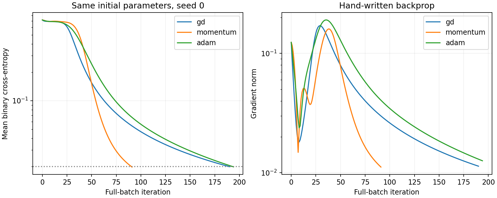
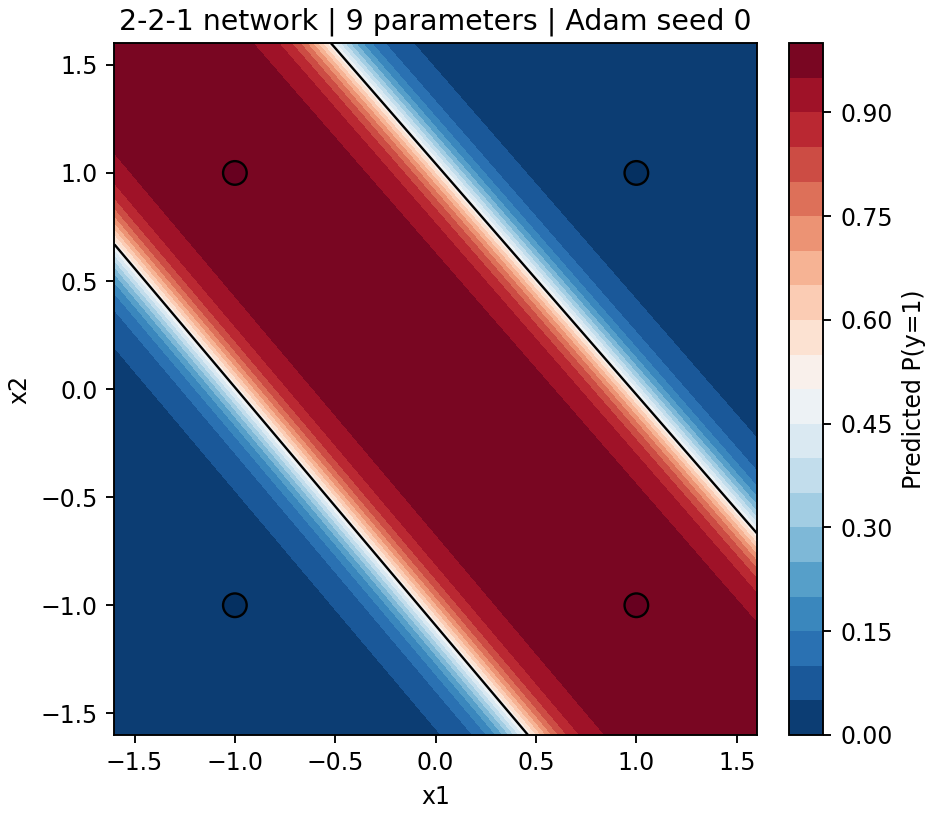
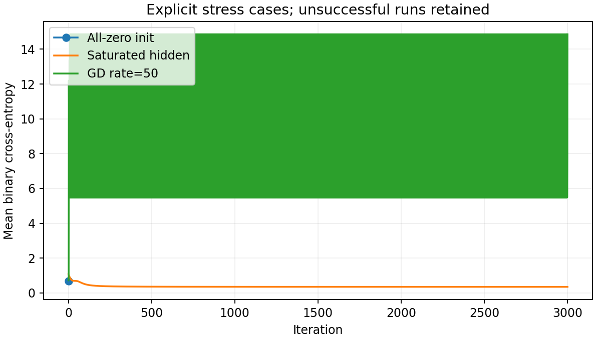

# 用9个参数学会 XOR：实现、卡点与关键内容

## 先看这个实验到底完成了什么

这个独立练习把神经网络训练缩小到四个样本、九个参数。模型、损失、反向传播，以及GD、动量、Adam更新都由NumPy直接实现；SciPy只作独立优化参照。没有深度学习框架帮我们隐藏梯度计算。

模型输入为(-1,-1)、(-1,1)、(1,-1)、(1,1)，标签分别为0、1、1、0。这里检验的是能否表示并学会完整XOR真值表，不把四点上的训练准确率称为独立测试准确率，也不声称模型在整个平面上的行为已经被验证。

这是一种教学上很小的网络，不声称是所有架构和算子定义下的绝对最小。对于这里采用的单隐藏层、单调激活结构，一个隐藏单元的输出阈值仍对应线性半空间，无法表达XOR；两个隐藏单元可以表达中间条带。

## 1. 九个参数如何组成一个模型

输入矩阵X有两列。第一层权重W1是2×2矩阵，偏置b1有两个数；输出层权重w2有两个数，输出偏置b2有一个数，总计4+2+2+1=9。

$$H=\tanh(XW_1+b_1),\qquad z=Hw_2+b_2,\qquad p=\sigma(z).$$

先把参数向量按固定顺序还原成这些对象，再前向计算。`model.py` 中 `unpack` 和 `forward` 只做这件事。每一行是一个样本，隐藏层有两个单元，输出是类别1的概率。

隐藏层提供了非线性。线性层叠加仍然是线性函数，单靠多乘几次矩阵无法把XOR分开。两个tanh单元可以分别识别一条带的两侧，再由输出层组合。训练得到的权重不必与手工构造相同，交换两个隐藏单元及其输出权重也不会改变函数。

## 2. 从损失推到梯度

使用平均二元交叉熵。实现直接由logit z计算，避免先把概率舍入成0或1后再取对数。

$$L=\frac{1}{n}\sum_j[\log(1+e^{z_j})-y_jz_j].$$

实际计算使用 `np.logaddexp(0,z)`，使很大的正负logit仍能得到有限结果。链式法则首先给出

$$\delta_j=\frac{\partial L}{\partial z_j}=\frac{p_j-y_j}{n}.$$

于是输出层梯度为

$$\nabla_{w_2}L=H^T\delta,\qquad\partial_{b_2}L=\sum_j\delta_j.$$

隐藏层误差为D_jh=δ_j w2_h (1-H_jh²)。最后计算

$$\nabla_{W_1}L=X^TD,\qquad\nabla_{b_1}L=\sum_j D_{j,:}.$$

容易错的地方是把均值的1/n除两次、漏掉tanh导数、矩阵转置错误，或参数展平与梯度展平顺序不一致。直接把网络训练到一个低损失，不能排除所有这类错误。

## 3. 如何知道反向传播写对了

我们对每一个参数作中心差分，独立比较损失的数值变化：

$$g_k^{FD}=\frac{L(\theta+h e_k)-L(\theta-h e_k)}{2h},\qquad h=10^{-5}.$$

检查3个随机种子、3种参数尺度，以及训练后的模型。既看最大绝对误差，也看整体相对误差，使用float64。`check_gradients.py`不调用另一套自动微分引擎，直接扰动参数计算损失，因而与手写链式法则相互独立。

另外检验全零驻点、极端logit稳定性和隐藏单元置换不变性。后者尤其有用，因为它是模型结构决定的性质，不依赖某一份“期望权重”。

## 4. 三种更新规则

GD每次沿负梯度前进。动量保留先前的更新方向，使用v_t=0.9v_(t-1)+g_t，再令θ_t=θ_(t-1)-ηv_t。Adam维护梯度和平方梯度的指数移动平均，分别除以1-0.9^t、1-0.999^t作偏差修正，再用平方根二阶矩和ε=1e-8缩放步长。

本次比较固定GD学习率1.0、动量学习率0.2、Adam学习率0.03。对每个种子，三种方法从完全相同的9个初始参数出发，使用完整四样本批次，最多10000次更新。成功要求平均BCE≤0.02且四样本全部分对；小梯度但未达到目标单独记为驻点失败。

这些学习率是实验设置，不是声称已为每个方法穷尽调优。不同设置下的结果不能推出某种优化器普遍最好。成功迭代数中位数仅在各方法自身成功的种子上计算；成功子集不同，因此必须连同失败数阅读。

## 5. 实际结果

固定主例为seed 0的Adam：194次更新后BCE=0.01991674，四点准确率100%。最大绝对梯度核对误差为3.59e-11，最大整体相对误差为3.87e-09。

| 方法 | 成功 / 20 | 失败 | 成功组迭代中位数 | 全部最终损失均值 |
|---|---|---|---|---|
| gd | 12 / 20 | 8 | 190 | 0.150637 |
| momentum | 12 / 20 | 8 | 88 | 0.150516 |
| adam | 10 / 20 | 10 | 229 | 0.183248 |

SciPy BFGS作为独立参照，在相同seed 0起点上达到BCE=8.85e-09、准确率100%。它用更严格的梯度停止条件，与我们的BCE目标停止条件不同，所以不把迭代数直接拿来排名。

## 6. 三个真实卡点

**全零初始化。** 所有隐藏输出为零，输出权重也为零。在平衡的XOR标签上，输出偏置梯度也恰好为零，因此所有9个梯度都是零。代码在第0步停止，损失ln2≈0.693147，准确率50%。这是“梯度为零不意味着已经学会”的精确例子。随机、不同的隐藏权重和小偏置能够打破这种对称性，但不保证所有随机起点都成功。

**隐藏层饱和。** 把主例初始隐藏层参数放大100倍，tanh大部分进入接近±1的区间，导数1-h²变得很小。输出层还可能调整，但隐藏特征难以移动；该压力实验3000次后仍未达到目标。不能把这种停滞简单归咎于“优化器坏了”，需要同时检查激活与梯度。

**步长过大。** GD学习率50的压力实验在3000次内未达标，损失反而很高。更新方向正确并不意味着任意距离都能下降。这个例子与饱和案例单列，不混进正常20种子的算法比较。

| 压力案例 | 最终BCE | 准确率 | 更新次数 | 停止原因 |
|---|---|---|---|---|
| all_zero | 0.693147 | 50% | 0 | stationary_before_target |
| saturated_hidden_x100 | 0.346966 | 75% | 3000 | iteration_cap |
| gd_learning_rate_50 | 14.860284 | 75% | 3000 | iteration_cap |

多种子结果还提示，某些起点会进入长期难以改进的区域。不能仅凭10000步没成功就证明落在严格局部极小点。若继续研究，可预先规定多次重启及其总计算预算，再按训练损失选模型；不能丢弃失败后只汇报最好的一次。

## 7. 如何理解“完成”和“最优”

分类正确、损失足够低、梯度正确，是三个不同的判断。此实验分别核验它们。对已经能分开的样本，把输出层权重继续放大可能使BCE继续趋近零；sigmoid在有限logit下不会严格等于0或1。因此本例的损失下确界可以是零，却不必存在达到零损失的有限参数解。停止在0.02是明示的工程标准，不是宣称找到有限参数全局最小值。

学完整个例子，最重要的是能说清四件事：非线性来自哪里，链式法则怎样穿过矩阵，初始化与饱和为什么影响梯度，以及数值停止条件究竟证明了什么。

## 8. 建议阅读顺序

先读 `model.py`，用纸重画各矩阵形状；再读 `check_gradients.py`，理解它为何能独立发现反向传播错误。随后读 `train.py`，对照三种更新递推。最后打开 `experiment.ipynb`，重跑主例、看结果表和压力案例；`run_experiment.py`可以重建全部多种子结果。

代码位于`src/minimal_neural_network/`，Notebook位于`notebooks/`，结果分为`results/tables/`、`results/figures/`与`results/artifacts/`。先按README在仓库根目录执行`python -m pip install -e .`，Notebook从子目录启动也能导入同一份代码。本项目不需要预算分配课程的数据、配置或仓库。

## 9. 来源和核验边界

采用中心差分、float64以及训练后再次核对梯度，参考 [Stanford CS231n 的梯度检查建议](https://cs231n.github.io/neural-networks-3/)。Adam的一阶/二阶矩和偏差修正按 [Kingma与Ba原论文](https://arxiv.org/abs/1412.6980) 实现。本文的九参数推导、XOR实验和失败结果来自本地代码运行。

代码、说明和实验由AI协助完成，并经过独立子代理复核。公开实验展示可检查的学习过程；它不表示用户已经亲自推导或掌握了所有步骤。
